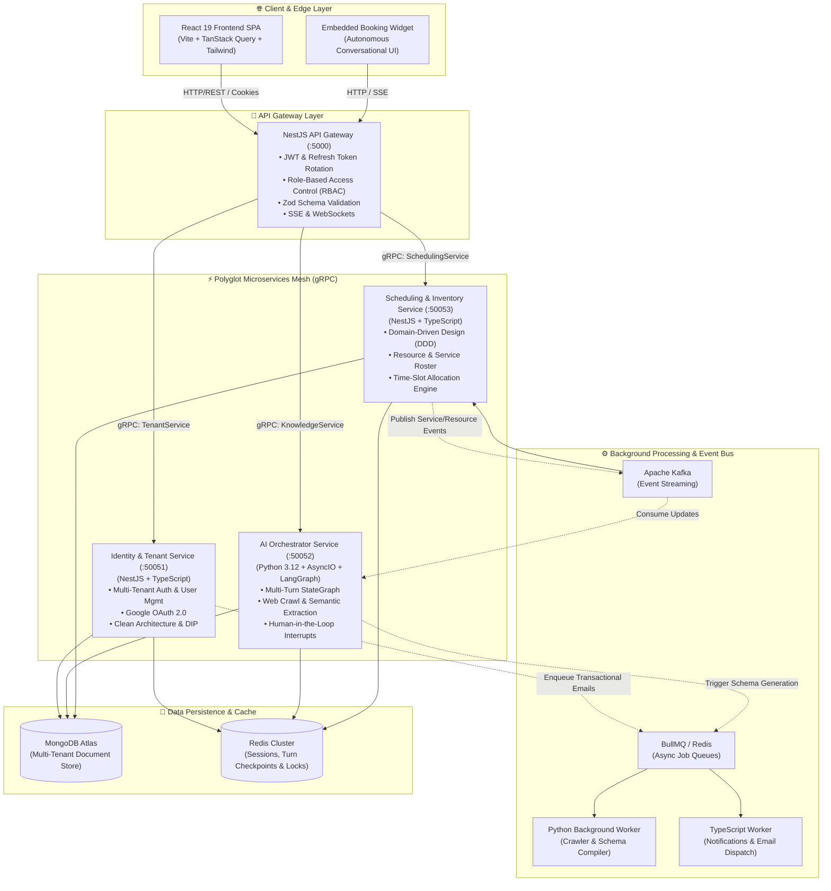
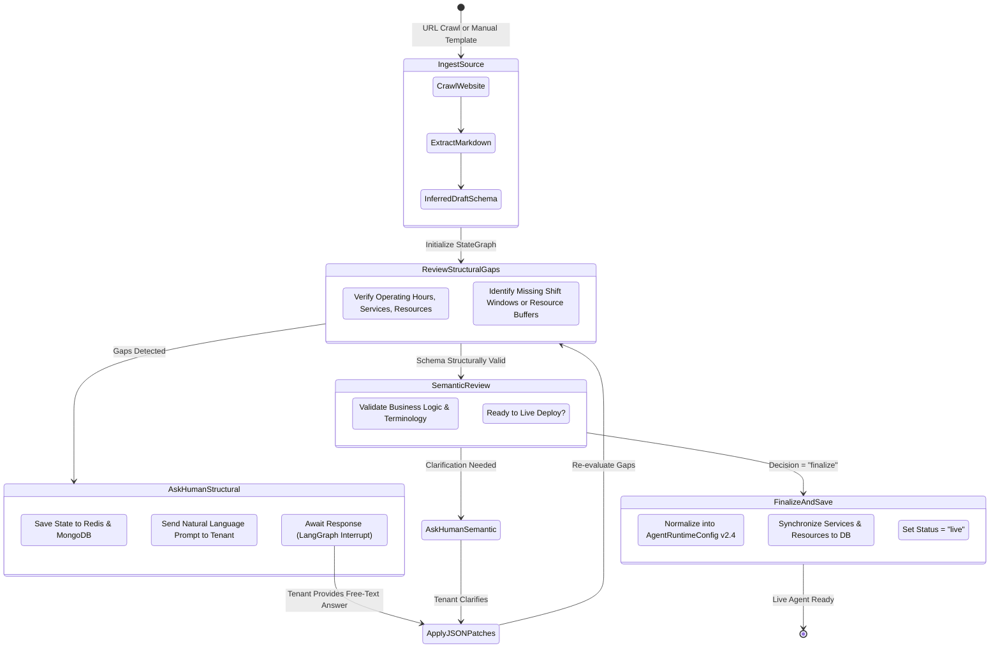

<div align="center">

# ⚡ Schedulux

### Autonomous Multi-Tenant AI Scheduling & Booking Platform

[](https://github.com/cjmatrix/Schedulux)
[](https://www.typescriptlang.org/)
[](https://www.python.org/)
[](https://nestjs.com/)
[](https://langchain-ai.github.io/langgraph/)
[](https://grpc.io/)
[](https://kafka.apache.org/)

<p align="center">
  <b>Schedulux</b> transforms conversational requirements, business rules, and raw website content into production-grade, multi-tenant scheduling engines powered by autonomous agentic workflows and polyglot microservices.
</p>

</div>

---

> [!WARNING]
> ### 🚧 Project Status: Active Development
> Schedulux is currently under **heavy active development**. Architectural interfaces, gRPC definitions, and schema specifications are evolving rapidly. Breaking changes and refactoring commits may occur across pre-release milestones.

---

## 📖 Overview

Configuring complex appointment and scheduling rules (doctor shifts, equipment sanitization buffers, multi-staff calendar allocations, dynamic operating windows, and pricing rules) has traditionally required tedious administrative forms or rigid SaaS tools.

**Schedulux** solves this by combining:
1. **Automated Site Crawling & Semantic Extraction**: Ingests public clinic, salon, or service URLs, parses content into structured markdown, and extracts business profiles, categories, resources, and operating hours.
2. **LangGraph Autonomous Onboarding Wizard**: A multi-turn conversational AI agent that identifies structural gaps (e.g., missing shift buffers, undefined eligible resources) and negotiates configuration changes via natural language.
3. **Interactive Visual Canvas**: A real-time React 19 workspace with a visual JSON-patch diff engine, test sandbox simulation, and live schema previews.
4. **Polyglot Event-Driven Microservices**: Distributed services built with **NestJS**, **Python (AsyncIO)**, **gRPC (Protocol Buffers)**, **Apache Kafka**, **Redis**, and **MongoDB**.

---

## 🏛️ System Architecture

Schedulux utilizes a **decoupled, polyglot microservices architecture** organized within a monorepo workspace managed via `pnpm` and `Turborepo`. Inter-service communication across the internal network is powered by **gRPC (HTTP/2 Protocol Buffers)** for high-throughput and sub-20ms latency, while asynchronous mutations stream over **Apache Kafka** and **BullMQ**.

### 🖼️ Architecture Diagram (Placeholder)


---

### 🧩 Microservices Topology



---

## 🤖 AI Orchestrator & LangGraph Workflow

The **AI Orchestrator** implements a stateful **LangGraph StateGraph** featuring dynamic checkpoints, conversational interrupts, and human-in-the-loop schema refinement.

### 🖼️ Agent Workflow Diagram (Placeholder)

```
+---------------------------------------------------------------------------------------------------------+
|                                                                                                         |
|                                    [ LANGGRAPH AGENT WORKFLOW DIAGRAM ]                                 |
|                                                                                                         |
|   ┌─────────────────────────────────────────────────────────────────────────────────────────────────┐   |
|   │ Place your agent graph flowchart image here:                                                    │   |
|   │ docs/assets/schedulux-agent-graph.png                                                           │   |
|   └─────────────────────────────────────────────────────────────────────────────────────────────────┘   |
|                                                                                                         |
+---------------------------------------------------------------------------------------------------------+
```

*(Visual agent workflow asset: `docs/assets/schedulux-agent-graph.png` — placeholder)*



---

## ✨ Core Capabilities

### 1. 🏢 Multi-Tenant Isolation & Role-Based Access Control
* **Tenant Scoping**: All database queries, caches, and scheduling locks are strictly scoped by `tenant_id`.
* **Hierarchical RBAC**: Fine-grained role hierarchy spanning `superadmin`, `tenant_owner`, `root`, `manager`, and `staff`.
* **Secure Session Architecture**: HttpOnly cookie-based JWT access tokens with sliding refresh token rotation stored and invalidated in Redis.

### 2. 🧙 Real-Time Agent Onboarding Wizard
* **Split-Screen Workspace**: Conversational chat on the left; real-time live schema canvas and sandbox testing simulator on the right.
* **Visual JSON-Patch Diff Engine**: Compares the baseline schema with current draft state using `fast-json-patch` and renders color-coded change highlights.
* **Dynamic Operating Hours Grouping**: Intelligently detects contiguous days with identical operating hours (e.g., `Mon – Thu: 09:00 AM – 06:00 PM` and `Fri – Sat: 10:00 AM – 02:00 PM`), eliminating rigid hardcoded assumptions.

### 3. 🎯 Domain-Driven Design (DDD) & Clean Architecture
* **Dependency Inversion Principle (DIP)**: Controllers and high-level use-cases depend purely on domain interfaces (`ITenantService`, `ISuperAdminService`, `IResourceRepository`), decoupling business logic from concrete gRPC, MongoDB, or HTTP implementations.
* **Command Query Responsibility Segregation (CQRS)**: Separates high-frequency read queries from state-mutating command handlers.

### 4. 🔄 Event-Driven Data Synchronization
* **Apache Kafka**: Streams domain events (e.g., `service.created`, `resource.updated`, `booking.confirmed`) to asynchronously update runtime agent configs without coupling microservices.
* **BullMQ**: Manages resilient background queues for crawling, schema validation, and transactional emails with exponential backoff retry policies.

---

## 📂 Monorepo Structure

```text
Schedulux/
├── apps/
│   ├── AI-orchestration/         # Python 3.12, LangGraph, LangChain, Beanie, AsyncIO gRPC
│   │   ├── src/agent_orchestrator/
│   │   │   ├── api/              # gRPC Servicers (Knowledge, Chat)
│   │   │   ├── domain/           # Business protocols, templates, exception definitions
│   │   │   ├── repositories/     # Beanie & Motor MongoDB repository implementations
│   │   │   ├── services/         # Agent, Onboarding, Crawler, & Memory services
│   │   │   └── tenant_agent.py   # LangGraph StateGraph agent definitions
│   │   └── pyproject.toml        # Managed with uv package manager
│   │
│   ├── api-gateway/              # NestJS Edge API Gateway (:5000)
│   │   ├── src/controllers/      # HTTP REST controllers (Tenant, Dashboard, Scheduling, Knowledge)
│   │   ├── src/guards/           # TenantAuthGuard, RolesGuard
│   │   └── src/utils/            # Cookie helpers, Zod validation pipes, Global error filters
│   │
│   ├── identity-tenant/          # NestJS gRPC Microservice (:50051)
│   │   ├── src/controllers/      # gRPC Controllers (Tenant, DashboardUser, SuperAdmin)
│   │   ├── src/interfaces/       # Pure domain interfaces for DIP / Clean Architecture
│   │   ├── src/services/         # TenantService, DashboardUserService, SuperAdminService
│   │   └── src/repository/       # MongoDB Mongoose repositories
│   │
│   ├── scheduling-inventory/     # NestJS Clean Architecture / DDD Microservice (:50053)
│   │   ├── src/application/      # Use-cases (Resource, Service, Inventory) & Interfaces
│   │   ├── src/domain/           # Domain Entities & Repository Contracts
│   │   ├── src/infrastructure/   # Mongo Repositories, Kafka Producers & Consumers
│   │   └── src/presentation/     # gRPC Controllers
│   │
│   ├── background-worker/        # Polyglot Asynchronous Task Workers
│   │   ├── src/workers/python-worker/   # Python worker for schema generation & validation
│   │   └── src/workers/typescript-worker/ # BullMQ email & event consumers
│   │
│   └── frontend-react/           # React 19 + Vite Frontend SPA (:5173)
│       ├── src/features/         # Modular feature slices (Tenant, Dashboard, SuperAdmin)
│       ├── src/pages/            # AgentOnboardingWizard, SchedulingOnboarding, Dashboard
│       └── src/store/            # Zustand state stores
│
├── packages/
│   └── proto/                    # Canonical Protocol Buffers & TypeScript gRPC definitions
│       ├── src/
│       │   ├── tenant.proto      # Tenant & SuperAdmin gRPC contracts
│       │   ├── dashboard.proto   # Workspace & Dashboard User contracts
│       │   ├── scheduling.proto  # Services, Resources, & Bookings contracts
│       │   └── knowledge.proto   # AI Agent, Crawler, & Message contracts
│       └── tsconfig.json
│
├── docs/
│   └── assets/                   # Architecture diagrams & walkthrough media (placeholders)
├── package.json                  # Root Monorepo configuration
├── pnpm-workspace.yaml           # pnpm workspace definition
└── README.md                     # Project documentation
```

---

## 🔌 Port & Service Matrix

| Service | Technology | Port | Protocol | Primary Responsibility |
| :--- | :--- | :---: | :---: | :--- |
| **API Gateway** | NestJS / Express | `5000` | HTTP / REST | Public Edge, Cookie-JWT Auth, Rate Limiting, Proxy |
| **Frontend SPA** | React 19 / Vite | `5173` | HTTP | Reactive Tenant Dashboard & Agent Onboarding Wizard |
| **Identity & Tenant** | NestJS / Mongoose | `50051` | gRPC | Tenant registration, auth, workspace members, RBAC |
| **AI Orchestrator** | Python / LangGraph | `50052` | gRPC | Multi-turn agent onboarding, schema compilation |
| **Scheduling Inventory** | NestJS / DDD | `50053` | gRPC | Services, resources, rosters, slot allocation engine |
| **Redis** | In-Memory Store | `6379` / Cloud | RESP | Session token rotation, draft caching, atomic locks |
| **MongoDB** | Document Database | `27017` / Cloud | Wire | Primary transactional persistence store |
| **Apache Kafka** | Distributed Log | `9092` | Kafka Wire | Inter-microservice asynchronous event streaming |

---

## 🚀 Getting Started

### Prerequisites

Ensure you have the following installed on your machine:
* **Node.js**: `v20.x` or higher
* **pnpm**: `v9.x` or higher (`npm install -g pnpm`)
* **Python**: `v3.12` or higher
* **uv**: Modern, ultra-fast Python package installer (`curl -LsSf https://astral.sh/uv/install.sh | sh`)
* **Docker & Docker Compose**: For local Redis, MongoDB, and Kafka instances

---

### Installation & Setup

1. **Clone the repository**:
   ```bash
   git clone https://github.com/cjmatrix/Schedulux.git
   cd Schedulux
   ```

2. **Install Node.js Monorepo Dependencies**:
   ```bash
   pnpm install
   ```

3. **Install Python AI Dependencies**:
   ```bash
   cd apps/AI-orchestration
   uv sync
   cd ../..
   ```

4. **Compile Protocol Buffers**:
   ```bash
   pnpm --filter @repo/proto build
   ```

---

### Environment Variables

Copy the `.env.example` templates in each respective application folder to `.env`:

```bash
# API Gateway
cp apps/api-gateway/.env.example apps/api-gateway/.env

# Identity & Tenant Service
cp apps/identity-tenant/.env.example apps/identity-tenant/.env

# Scheduling & Inventory Service
cp apps/scheduling-inventory/.env.example apps/scheduling-inventory/.env

# AI Orchestrator
cp apps/AI-orchestration/.env.example apps/AI-orchestration/.env
```

Ensure your `.env` files contain valid connection strings for:
* `MONGO_URI`
* `REDIS_URI`
* `JWT_SECRET` and `JWT_REFRESH_SECRET`
* `GEMINI_API_KEY` or `GROQ_API_KEY` (for AI Orchestrator)

---

### Running Locally

To run all microservices, workers, and the frontend concurrently:

```bash
pnpm dev
```

You can also run individual services as needed:

```bash
# Run API Gateway only
pnpm dev:gateway

# Run Identity & Tenant gRPC microservice
pnpm dev:identity

# Run Scheduling & Inventory gRPC microservice
pnpm dev:scheduling

# Run Python AI Orchestration gRPC server
pnpm dev:ai:grpc

# Run Frontend React SPA
pnpm dev:frontend

# Run Background Task Workers
pnpm dev:worker
pnpm dev:worker:python
```

---

## 🗺️ Roadmap & Current Focus

- [x] Monorepo scaffold with Protocol Buffers (`@repo/proto`)
- [x] Multi-tenant identity, authentication, and Redis refresh token rotation
- [x] LangGraph StateGraph with structural & semantic evaluation loops
- [x] Real-time Agent Onboarding Wizard with visual JSON-patch diff drawer
- [x] Dynamic operating schedule grouping across multi-day shifts
- [x] Scheduling & Inventory Clean Architecture with Domain-Driven Design (DDD)
- [ ] Multi-provider calendar sync (Google Calendar, Outlook)
- [ ] End-to-end booking reservation engine with atomic Redis distributed locks
- [ ] Embeddable client-side Web Component / Iframe chat & booking widget
- [ ] Comprehensive Prometheus & Grafana telemetry dashboards

---

## 👨‍💻 Author

**Al Muhammed Yazeen**
* **GitHub**: [@cjmatrix](https://github.com/cjmatrix)
* **LinkedIn**: [Yazeen GP](https://www.linkedin.com/in/yazeen-gp-69b321255)
* **Email**: cjmartingarrix@gmail.com

---

## 📄 License

This project is licensed under the [MIT License](LICENSE).
