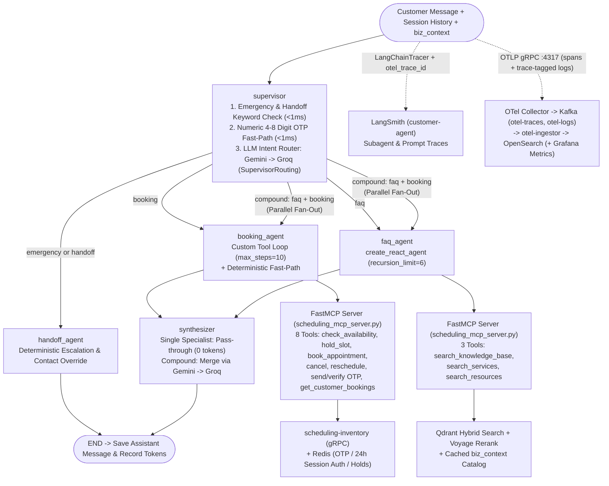
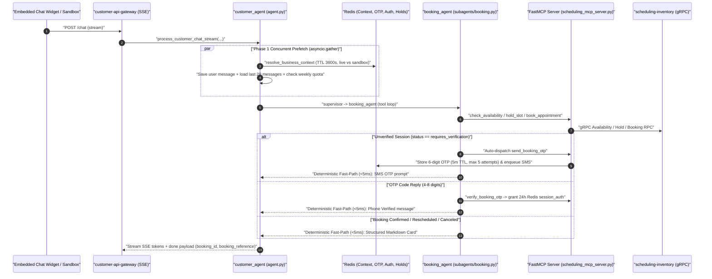

# Customer Booking & Support Agent (`customer_agent`)

The **Customer Agent** is Schedulux's public-facing conversational concierge embedded on client websites via `@repo/widget` (`client-api.schedulux.xyz`) and tested inside the Tenant Sandbox (`mode="sandbox"`). Built on **LangGraph**, it combines zero-latency guardrails, parallel specialist fan-out, **FastMCP** scheduling tools over gRPC, Redis session OTP auth, and deterministic fast-path rendering.

**Primary Code Modules:**
- Graph orchestration, streaming & token tracking: `apps/AI-orchestration/src/agent_orchestrator/workflows/customer_agent/agent.py`
- State & business context resolver: `workflows/customer_agent/state.py`, `workflows/customer_agent/context.py`
- Specialist subagents: `workflows/customer_agent/subagents/supervisor.py`, `booking.py`, `faq.py`, `handoff.py`
- Deterministic fast-path response formatter: `workflows/customer_agent/fast_path.py`
- FastMCP tool registry & gRPC bridge: `apps/AI-orchestration/src/agent_orchestrator/mcp/scheduling_mcp_server.py`
- Shared provider factory (Gemini → Groq): `apps/AI-orchestration/src/agent_orchestrator/workflows/llm_factory.py`

---

## 1. LangGraph Multi-Agent Orchestration Topology

The compiled graph (`build_customer_orchestration_graph` in `customer_agent/agent.py`) routes every customer message through `supervisor`, fans out to one or both specialists concurrently on compound queries, and merges results in `synthesizer`.

---

## 2. End-to-End Booking, OTP Verification & Fast-Path Sequence

---

## 3. Core Subsystems & Engineering Design

### Concurrent Request Initialization & Isolation
In `process_customer_chat` and `process_customer_chat_stream`, Phase 1 uses `asyncio.gather(...)` to execute independent I/O in parallel before invoking LangGraph:
1. Persist incoming user turn (`CustomerMessageRepository.save_message`).
2. Fetch recent conversation context (last 20 turns).
3. Resolve tenant `biz_context` via `resolve_business_context(tenant_id, agent_id, is_sandbox)`: checks Redis (`live` vs `sandbox` namespace, 3600s TTL), falling back to MongoDB `AgentRuntimeConfig` (live) or `AgentDraft` (sandbox).
4. Enforce subscription weekly AI token limits (`TokenTrackingService.check_weekly_quota`).

### Supervisor Guardrails & Fast-Path Routing (`supervisor.py`)
- **Zero-LLM Guardrails:** Checks `biz_context["guardrails"]` before any LLM call:
  - `triage_emergency.keywords` → immediately triggers `emergency` handoff.
  - `human_handoff.trigger_topics` → immediately triggers `handoff`.
  - Numeric 4–8 digit replies (`.isdigit()`) → fast-paths directly to `["booking"]` in `<1ms` for OTP verification turns.
- **Compound Intent Routing:** Uses `SupervisorRouting` (`Literal["booking", "faq", "handoff"]`) with the last 6 messages to trigger **parallel fan-out** (`["faq_agent", "booking_agent"]`) when a customer asks both policy/pricing questions and availability/booking requests in one message.

### FastMCP Tool Integration & Specialist Scopes (`mcp/scheduling_mcp_server.py`)
`get_scheduling_mcp_tools()` exposes FastMCP tools as LangChain `StructuredTool`s, strictly partitioned per specialist:

| Specialist | Allowed MCP Tools |
| :--- | :--- |
| **`booking_agent`** | `check_availability`, `hold_slot`, `book_appointment`, `cancel_appointment`, `reschedule_appointment`, `send_booking_otp`, `verify_booking_otp`, `get_customer_bookings` |
| **`faq_agent`** | `search_knowledge_base`, `search_services`, `search_resources` |

### Booking Agent Precision, OTP Auth & Fast-Path (`booking.py`, `fast_path.py`)
- **Zero-Hallucination Calendar Anchor:** `_build_booking_request_context` pre-calculates a 14-day local date reference table in the business timezone (`Today`, `Tomorrow`, `This Coming ...`, `Next ...`) so LLMs never miscompute relative dates.
- **24-Hour Verified Session Injection:** Reads `get_session_auth(session_id)` from Redis; once verified via OTP, the booking prompt injects the customer's verified phone number and explicitly blocks redundant OTP prompts.
- **Auto-OTP Dispatch:** If a protected tool (`book_appointment`, `cancel_appointment`, `reschedule_appointment`, `get_customer_bookings`) returns `status: "requires_verification"`, `_execute_booking_turn` immediately triggers `send_booking_otp` without needing another LLM step.
- **Deterministic Fast-Path (`format_deterministic_fast_path`):** Intercepts successful JSON responses from `send_booking_otp`, `verify_booking_otp`, `book_appointment`, `reschedule_appointment`, `cancel_appointment`, and `get_customer_bookings` and renders verified Markdown confirmation cards in `<5ms` with zero extra LLM summary tokens.

### FAQ Agent, Synthesizer & Resilience
- **Hybrid RAG FAQ Specialist (`faq.py`):** Runs `create_react_agent` (`recursion_limit=6`) backed by `search_knowledge_base` (Voyage dense + BM25 sparse Qdrant hybrid search + Voyage reranking) plus service/resource catalog search and the business owner's `supervisor_prompt`.
- **Compound Synthesizer (`node_synthesizer`):** Passes single-specialist replies straight through with zero overhead; on compound turns, merges FAQ and booking answers while resolving contradictory disclaimers.
- **SSE Token Filtering & Provider Failover:** `process_customer_chat_stream` streams `on_chat_model_stream` tokens only from `booking_agent`, `faq_agent`, and `synthesizer` (hiding internal supervisor JSON), uses **Gemini primary → Groq fallback** across all LLM calls (`llm_factory.py`), and persists the final assistant message and token usage concurrently via `asyncio.gather`.
- **Correlated Observability (LangSmith + OTel → Kafka → OpenSearch):** Every run attaches `LangChainTracer(project_name="customer-agent")` with `otel_trace_id` metadata alongside OTLP gRPC (`:4317`) spans and logs routed through **OTel Collector → Kafka (`otel-traces`, `otel-logs`) → `otel-ingestor` → OpenSearch** (and metrics to Grafana Cloud).
