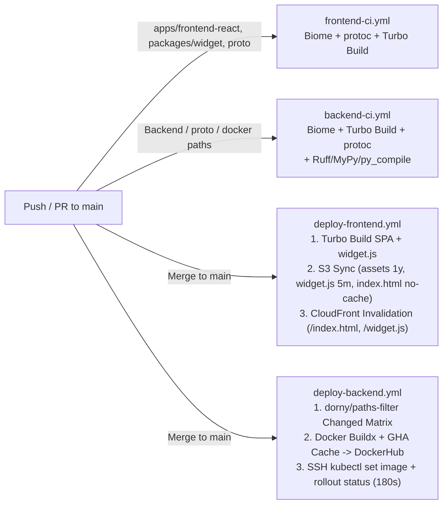

# Local Development & Production Deployment Guide

This guide covers running Schedulux locally, understanding the automated GitHub Actions CI/CD pipelines, and provisioning/operating the production AWS + K3s stack.

---

## 1. Local Development Quick Start

### Prerequisites
- **Node.js 22+** & **`pnpm@11.20.0`**
- **Python 3.12+** & **`uv`**
- **`protoc`** (Protocol Buffers compiler, e.g. `sudo apt install protobuf-compiler`)
- **Docker** (for local RabbitMQ and optional local OTel containers via `docker-compose.yml`)
- Configured `.env` files (external managed services: MongoDB, Redis, Kafka, Qdrant, OpenSearch, Voyage/Gemini/Groq keys, or `MOCK_LLM=true` for mocked chat runs)

### Start Everything Locally
```bash
git clone https://github.com/cjmatrix/Schedulux.git && cd Schedulux
pnpm install
pnpm build:proto:py          # Generate Python gRPC stubs from packages/proto/src/*.proto
pnpm rabbitmq:up              # Start RabbitMQ (:5672 / UI :15672)
pnpm dev                      # Launch gateways, core services, workers, and React UI concurrently
```

### Verification & Load Testing Scripts
```bash
pnpm check                    # Biome lint & format check (TS/JS workspace)
pnpm check:py                 # Ruff lint/format + MyPy typecheck (apps/AI-orchestration)
pnpm build                    # Full Turborepo workspace build
pnpm loadtest:quick           # Quick mocked load test sanity check
```

---

## 2. CI/CD Pipelines (`.github/workflows/`)



- **Path-Filtered Smart Backend Builds (`deploy-backend.yml`):** Only changed services rebuild and deploy. Changes in `packages/proto/**`, `packages/circuit-breaker/**`, `docker/Dockerfile.node`, or `pnpm-lock.yaml` automatically fan out to all affected Node.js services; `packages/proto/**` also triggers `ai-orchestration` rebuilds (`grpc_tools.protoc` compiles stubs inside `Dockerfile.python`). Supports manual `workflow_dispatch` per service or `all`.
- **Zero-Downtime Frontend Rollout (`deploy-frontend.yml`):** Uploads hashed `/assets/*` **first** (without deleting old chunks so active tabs never 404), followed by `/widget.js` (`max-age=300`, `application/javascript`), `/index.html` (`no-cache`), and a targeted CloudFront invalidation for `/index.html` and `/widget.js`.

---

## 3. Initial Cloud Provisioning & K3s Bootstrap

### Step 1: Provision AWS Infrastructure with Terraform
```bash
cd infra/terraform
terraform init
terraform apply
```
Record `ec2_public_ip`, `frontend` CloudFront domain/distribution ID, and `rag_storage` bucket outputs, then map DNS records for `schedulux.xyz`:
- **A Records:** `api`, `client-api`, and `*` → `<EC2_PUBLIC_IP>`
- **CNAME / Alias:** `app` → `<CLOUDFRONT_DOMAIN>`

### Step 2: Install K3s, Traefik ACME, Doppler Operator & KEDA on EC2
```bash
ssh -i infra/terraform/schedulux-dev-key.pem ubuntu@<EC2_PUBLIC_IP>

# 1. Configure K3s low disk-pressure thresholds & install K3s
sudo mkdir -p /etc/rancher/k3s
sudo tee /etc/rancher/k3s/config.yaml << 'EOF'
kubelet-arg:
  - "eviction-hard=imagefs.available<5%,nodefs.available<5%"
  - "eviction-minimum-reclaim=imagefs.available=1%,nodefs.available=1%"
EOF
curl -sfL https://get.k3s.io | sh -s - --write-kubeconfig-mode 644

# 2. Install Helm, Doppler Operator & KEDA
curl https://raw.githubusercontent.com/helm/helm/main/scripts/get-helm-3 | bash
helm repo add doppler https://helm.doppler.com && helm repo add kedacore https://kedacore.github.io/charts && helm repo update
helm install doppler-operator doppler/doppler-kubernetes-operator --namespace doppler-operator-system --create-namespace
helm install keda kedacore/keda --namespace keda --create-namespace
```
Copy `k8s/traefik-config.yaml` to `/var/lib/rancher/k3s/server/manifests/traefik-config.yaml` on EC2 so Traefik automatically issues Let's Encrypt TLS certificates.

### Step 3: Deploy K3s Workloads
```bash
scp -i infra/terraform/schedulux-dev-key.pem -r k8s ubuntu@<EC2_PUBLIC_IP>:~/
ssh -i infra/terraform/schedulux-dev-key.pem ubuntu@<EC2_PUBLIC_IP>
kubectl apply -f ~/k8s/base/doppler-secrets.yaml
kubectl apply -k ~/k8s/base/
kubectl get pods -n schedulux
```

---

## 4. Day-2 Operations & Secret Rotation

- **Deploying Code Changes:** Push to `main`—GitHub Actions rebuilds changed containers/SPA bundles and rolls K3s deployments automatically (`kubectl set image ...`).
- **Deploying K8s Manifest Changes (`k8s/base/**`):** `deploy-backend.yml` only triggers on application/Docker code changes, so apply manifest updates manually on EC2 (`kubectl apply -f ~/k8s/base/<file>.yaml`).
- **Rotating Environment Secrets via Doppler:**
  1. Update the secret in Doppler (`prd` or `prd_<service>`).
  2. Wait ~60 seconds for the Doppler Kubernetes Operator to sync the K8s `Secret`.
  3. Restart the target pod(s) so containers load the refreshed environment variables:
     ```bash
     kubectl rollout restart deployment/<service-name> -n schedulux
     ```
