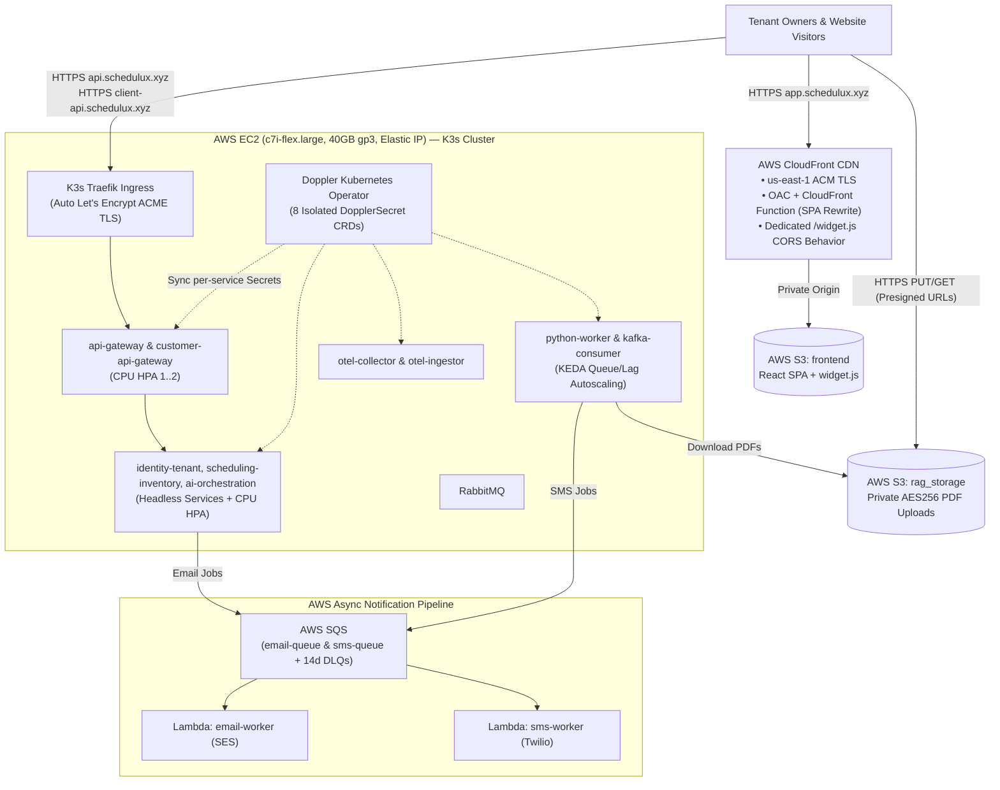

# Cloud Infrastructure & Zero-Secret GitOps

Schedulux runs on a hybrid AWS serverless + single-cluster K3s architecture provisioned via **modular Terraform** (`infra/terraform/`), edge-routed through **CloudFront** and **Traefik**, secured with **Let's Encrypt TLS**, and hydrated at runtime by the **Doppler Kubernetes Operator**.

---

## 1. AWS Cloud, Edge CDN & K3s Topology

---

## 2. Modular Terraform Architecture (`infra/terraform/`)

All AWS infrastructure lives under `infra/terraform/main.tf` and is split into focused, reusable modules:

| Module | Resources Provisioned | Key Design Details |
| :--- | :--- | :--- |
| **`modules/ec2`** | Ubuntu 24.04 EC2 (`c7i-flex.large`), 40GB encrypted `gp3` EBS (`3000` IOPS), RSA-4096 SSH key, Security Group (`22`, `80`, `443`, `6443`), Elastic IP | Allocates static EIP for DNS A records (`api`, `client-api`, `*`) and disables UFW blocking on container ports via `user_data` |
| **`modules/frontend`** | Private S3 bucket, OAC, `us-east-1` ACM SSL certificate, CloudFront Function (`cloudfront-js-2.0`), Cache & CORS Response Policies, CloudFront Distribution | **Split Routing:** Extensionless React Router URLs rewrite to `/index.html` (`no-cache`), `/assets/*` cache immutably (`1y`), and `/widget.js` bypasses SPA rewrite with `Access-Control-Allow-Origin: *` (`5m` TTL) |
| **`modules/rag_storage`** | Private S3 bucket (`prevent_destroy = true`, AES256 + Bucket Key, public access blocked) | Configures `PUT`/`GET`/`HEAD` CORS for `app.schedulux.xyz` so browsers upload PDFs directly via presigned URLs |
| **`modules/sqs`** | `email-queue` + `email-dlq`, `sms-queue` + `sms-dlq` | Managed SSE, configurable `maxReceiveCount`, redrive allow policies, and 14-day (`1209600s`) DLQ retention |
| **`modules/lambda_email`** | IAM role/policy + CloudWatch log group + SQS-triggered Lambda | Consumes `email-queue` and sends transactional workspace/booking emails via AWS SES |
| **`modules/lambda_sms`** | IAM role/policy + CloudWatch log group (14d retention) + SQS-triggered Lambda | Consumes `sms-queue` and dispatches SMS OTPs and booking alerts via Twilio |
| **`budget.tf`** | AWS Budgets monthly threshold alert | Notifies on spend approaching `monthly_budget_limit` (default `$30`) |

---

## 3. Kubernetes (K3s) Runtime & Zero-Secret GitOps

### Edge Ingress & Automatic TLS (`k8s/base/ingress.yaml`, `k8s/traefik-config.yaml`)
- K3s runs built-in **Traefik** configured via `HelmChartConfig` at `/var/lib/rancher/k3s/server/manifests/traefik-config.yaml`.
- All port `80` HTTP traffic redirects to `websecure` (`443`), and Traefik automatically provisions & renews Let's Encrypt ACME certificates for `api.schedulux.xyz` (`api-gateway-svc:5000`) and `client-api.schedulux.xyz` (`customer-api-gateway-svc:5001`).

### Least-Privilege Per-Service Doppler Isolation (`k8s/base/doppler-secrets.yaml`)
- No `.env` files or raw API keys are committed to Git.
- The **Doppler Kubernetes Operator** watches **8 scoped `DopplerSecret` CRDs**, keeping each pod's blast radius limited to its own credentials:
  - `schedulux-secrets` (shared infra used by `otel-collector` and `otel-ingestor`)
  - Dedicated secrets per service: `api-gateway-secrets`, `customer-api-gateway-secrets`, `identity-tenant-secrets`, `scheduling-inventory-secrets`, `ai-orchestration-secrets`, `crawler-worker-secrets`, and `kafka-consumer-secrets`.

### Autoscaling (HPA + KEDA)
- **Horizontal Pod Autoscalers (`autoscaling/v2`):** Scale `api-gateway`, `customer-api-gateway`, `identity-tenant`, `scheduling-inventory`, and `ai-orchestration` (`minReplicas: 1`, `maxReplicas: 2`, `75%` CPU target, `300s` scale-down stabilization).
- **KEDA Event-Driven Scalers (`keda.sh/v1alpha1`):**
  - `kafka-consumer-scaler`: Scales `kafka-consumer` on Kafka consumer group lag.
  - `crawler-worker-scaler`: Scales the Python crawler/indexer deployment on RabbitMQ `knowledge-document-indexing-queue` backlog (`QueueLength >= 2`).

---

## 4. Optimized Non-Root Container Builds (`docker/`)

- **`docker/Dockerfile.node`:** 4-stage Alpine build (`node:22-alpine`) using `npx turbo prune ${APP_NAME} --docker`, `node-linker=hoisted` for flat `node_modules`, Protobuf compiler (`protobuf`), and non-root execution as `nestjs` (`uid 1001`).
- **`docker/Dockerfile.python`:** 2-stage `uv` + `python:3.12-slim-bookworm` build compiling `packages/proto/src/*.proto` into `agent_orchestrator/proto` via `grpc_tools.protoc` during image build, running as non-root `appuser`.
- **`docker/Dockerfile.python-worker`:** 2-stage `uv` + `python:3.12-slim-bookworm` image installing Playwright Chromium system dependencies (`playwright install-deps chromium` + `playwright install chromium`) for headless JS crawling under non-root `appuser`.
