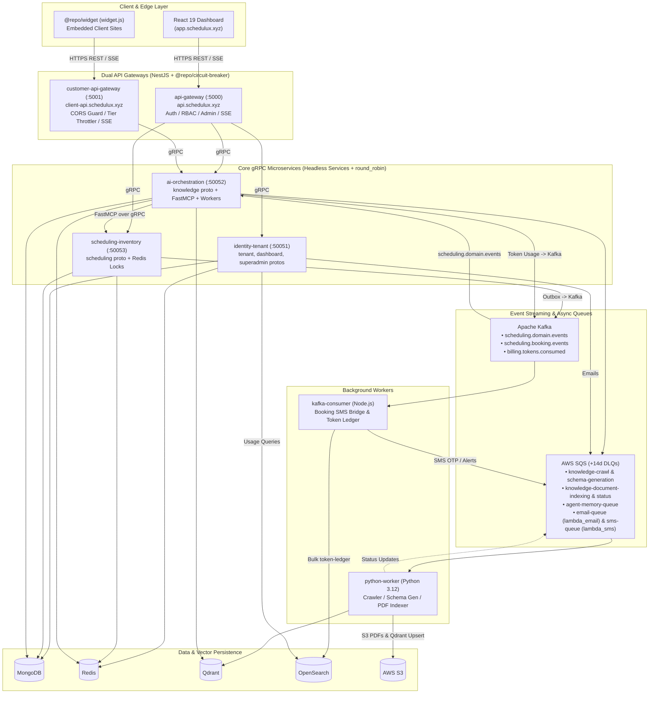

# Microservices Architecture & Monorepo Topology

Schedulux is built as a **polyglot pnpm + Turborepo monorepo** combining TypeScript/NestJS services with Python 3.12 AsyncIO AI/worker runtimes. Internal synchronous RPC runs over **gRPC (HTTP/2 Protobuf)** via Kubernetes Headless Services (`round_robin`), while mutations, billing ledgers, crawling, and notifications stream asynchronously across **Apache Kafka** and **AWS SQS** (+ Lambda workers).

---

## 1. End-to-End Service & Messaging Mesh



---

## 2. Service-by-Service Architecture

### Dual API Gateways (BFF Isolation)
Splitting tenant administration from public customer widget traffic prevents chat spikes from degrading dashboard controls and enforces tailored rate-limit and CORS policies.

- **`api-gateway` (`apps/api-gateway`, port `:5000`, `api.schedulux.xyz`)**
  - Serves the React 19 SaaS dashboard across 6 controller domains (`tenant`, `dashboarduser`, `billing`, `scheduling`, `agentOrchestrator`, `superadmin`).
  - Enforces `TenantAuthGuard`, `RolesGuard`, `PaddleWebhookGuard`, `CrawlQuotaGuard`, `TenantTokenQuotaGuard`, and global Redis-backed `@nestjs/throttler` (`short`: 30 req/1s, `default`: 100 req/60s, `long`: 1000 req/900s).
  - Registers all 5 gRPC packages (`TENANT_PACKAGE`, `DASHBOARD_PACKAGE`, `SUPERADMIN_PACKAGE`, `KNOWLEDGE_PACKAGE`, `SCHEDULING_PACKAGE`).
- **`customer-api-gateway` (`apps/customer-api-gateway`, port `:5001`, `client-api.schedulux.xyz`)**
  - Dedicated public chat ingress for `@repo/widget` (`CustomerChatController` REST + SSE).
  - Applies `CorsOriginGuard` (validating origin against tenant `whitelisted_domains`), `CustomerThrottlerGuard` (dynamic per-tenant RPM fetched from Redis via `getTierRateLimit`), and `TenantTokenQuotaGuard`.

### Core Domain & AI Microservices

- **`identity-tenant` (`apps/identity-tenant`, gRPC `:50051`)**
  - Owns authentication (JWT + Google OAuth), workspace RBAC, superadmin operations, Paddle billing webhooks, subscription tier quotas (`TierConfigRepository`), and `OpenSearchAnalyticsService` (reads aggregated token usage from `token-ledger`).
  - Dispatches transactional emails via `SqsEmailProducer` (`AWS_SQS_EMAIL_QUEUE_URL`).
- **`scheduling-inventory` (`apps/scheduling-inventory`, gRPC `:50053`)**
  - Owns services, staff/equipment resources, weekly shifts, deterministic slot availability, and transactional booking mutations (`BookingModule`, `InventoryModule`, `ScheduleModule`, `ServiceModule`, `ResourceModule`).
  - Uses **Redis atomic slot holds/locks** and pure-write transactions paired with a **Transactional Outbox** (`outbox-recovery.service.ts`) publishing to Kafka topics `scheduling.domain.events` and `scheduling.booking.events`.
- **`ai-orchestration` (`apps/AI-orchestration`, gRPC `:50052`)**
  - Single AsyncIO supervisor (`main.py`) running five concurrent loops:
    1. **gRPC Server (`serve()`):** Hosts `knowledge.proto` RPCs (Tenant Onboarding Agent, Customer Agent, Document URLs, Crawling, Chat History).
    2. **Kafka `SchedulingConsumer`:** Consumes `scheduling.domain.events` to keep `AgentRuntimeConfig`, `AgentDraft`, and Redis `biz_context` caches synchronized with inventory edits.
    3. **SQS `run_memory_worker`:** Summarizes long tenant onboarding transcripts (`agent-memory-queue`) and writes permanent facts to Qdrant (`agent_semantic_memory`).
    4. **SQS `DocumentStatusConsumer`:** Consumes `knowledge-document-status-queue` (`SqsEventSubscriber`) and updates MongoDB `KnowledgeDocument` statuses (`indexing` / `indexed` / `failed`).
    5. **Outbox Recovery (`run_outbox_recovery_loop`):** Reliably retries unsent token/event outbox records every 10 seconds.

### Asynchronous Workers

- **`python-worker` (`apps/python-worker/worker.py`)**
  - Long-polls AWS SQS queues (`WaitTimeSeconds=20`, DLQ redrive via Terraform) with W3C `traceparent` extraction:
    - `knowledge-crawl-queue` (+ DLQ) → `process_crawl_job` (`crawler.py`)
    - `schema-generation-queue` (+ DLQ, with Redis Claim Check for large crawl payloads) → `process_schema_generation` (`schema_generator.py`)
    - `knowledge-document-indexing-queue` (+ DLQ) → `process_document_indexing` (`document_indexer.py`)
- **`kafka-consumer` (`apps/kafka-consumer/src/index.ts`)**
  - Runs two independent KafkaJS consumers:
    - **`bookingEventsConsumer` (`scheduling.booking.events`):** Validates and forwards SMS OTP / booking confirmation notifications to **AWS SQS** (`AWS_SQS_SMS_QUEUE_URL` → `lambda_sms` / Twilio) with OTel trace context attributes.
    - **`tokenLedgerConsumer` (`billing.tokens.consumed`):** Bulk-indexes `customer_agent` and `tenant_agent` token consumption events into the **OpenSearch `token-ledger`** index (`_id: doc.event_id` for idempotent writes).

---

## 3. Shared Monorepo Packages (`packages/`)

| Package | Purpose | Key Details |
| :--- | :--- | :--- |
| **`@repo/proto`** | Single source of truth for gRPC contracts | `tenant.proto`, `dashboard.proto`, `superadmin.proto`, `knowledge.proto`, `scheduling.proto` compiled for TS (`ts-proto`) and Python (`grpc_tools.protoc`) |
| **`@repo/circuit-breaker`** | Downstream gRPC resilience (Opossum) | Adaptive timeouts (`45s` LLM stream, `25s` chat/onboarding/crawl, `5s` default); skips tripping on HTTP `4xx` and gRPC validation codes (`3, 5, 6, 7, 8, 9, 16`) |
| **`@repo/widget`** | Embeddable zero-code chat widget | Preact + TanStack Query compiled via Vite into `widget.js` and deployed to S3 + CloudFront alongside `apps/frontend-react` |

---

## 4. Internal gRPC Load Balancing (`Headless` + `round_robin`)

Standard Kubernetes `ClusterIP` Services load-balance at the L4 TCP connection level, which pins long-lived HTTP/2 gRPC connections to a single pod when HPA scales replicas out.

To solve this, `identity-tenant`, `ai-orchestration`, and `scheduling-inventory` define **Headless Services (`clusterIP: None`)** alongside `ClusterIP` Services in `k8s/base/`. Both `api-gateway` and `customer-api-gateway` configure gRPC clients with:

```json
{ "loadBalancingConfig": [{ "round_robin": {} }] }
```

DNS resolution against `<service>-headless.schedulux.svc.cluster.local:<port>` returns all pod A-records, allowing the gRPC client to distribute RPC calls across every active replica cleanly.
