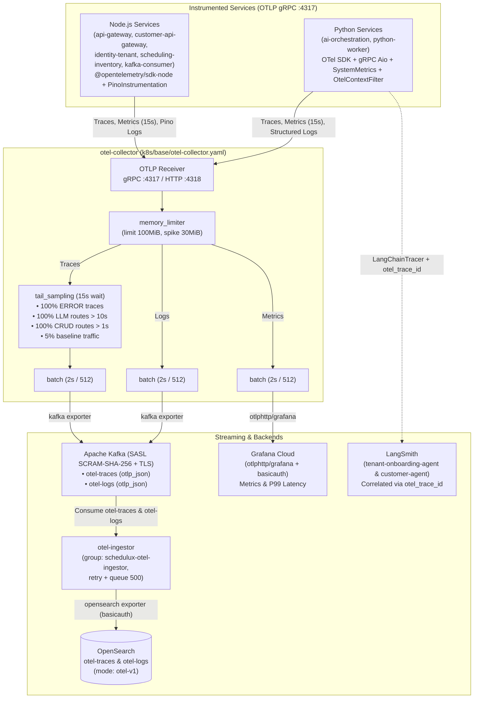
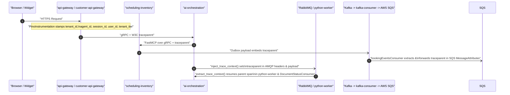

# Distributed Observability Pipeline (Traces, Metrics & Logs)

Schedulux implements end-to-end **OpenTelemetry** instrumentation across TypeScript/NestJS and Python 3.12 services, paired with **tail-based trace sampling**, **Kafka-buffered OpenSearch ingestion**, **Grafana Cloud metrics**, and **LangSmith `otel_trace_id` correlation**.

**Primary Code & Manifest Modules:**
- Collector & tail sampling config: `k8s/base/otel-collector.yaml`, `infra/observability/otel-collector-config.yaml`
- Kafka-to-OpenSearch ingestor: `k8s/base/otel-ingestor.yaml`
- Node.js OTel SDK & Pino hook: `apps/*/src/tracing.ts` (`api-gateway`, `customer-api-gateway`, `identity-tenant`, `scheduling-inventory`, `kafka-consumer`)
- Python OTel SDK & gRPC/logging instrumentation: `apps/AI-orchestration/src/agent_orchestrator/tracing.py`, `apps/python-worker/src/python_worker/tracing.py`
- Async trace context bridges: `apps/scheduling-inventory/src/infrastructure/messaging/scheduling-events.producer.ts`, `apps/kafka-consumer/src/consumers/bookingEventsConsumer.ts`, `apps/python-worker/src/python_worker/queues.py`

---

## 1. End-to-End Telemetry Collection & Routing Pipeline

---

## 2. Intelligent Tail-Based Sampling (`otel-collector.yaml`)

Rather than dropping traces blindly at the edge (head sampling) or storing 100% of noisy health checks, `otel-collector` buffers spans for `decision_wait: 15s` (`num_traces: 10000`) and selectively retains traces that matter:

| Policy Name | Condition | Retention | Why |
| :--- | :--- | :--- | :--- |
| **`keep-all-errors`** | Span `status_code == ERROR` | **100%** | Never lose exceptions, gRPC failures, or 5xx errors |
| **`keep-slow-llm-traces`** | `http.route` matches `/api/v1/public/chat` or `/api/v1/tenant/knowledge/onboarding/{start,message,sandbox}` AND latency `>= 10,000ms` | **100%** | Separates normal multi-turn LLM latency from genuinely slow RAG/agent turns |
| **`keep-slow-crud-traces`** | Any non-LLM `http.route` (`invert_match: true`) AND latency `>= 1,000ms` | **100%** | Flags slow DB queries, Redis lock contention, or downstream timeouts |
| **`sample-normal-traffic`** | All remaining healthy requests | **5%** | Provides baseline P50/P95/P99 visibility at low storage cost |

---

## 3. Cross-Process W3C Trace Context Propagation

Schedulux maintains a single continuous `trace_id` across synchronous RPCs, asynchronous queues, and external LLM traces:

### Multi-Tenant Context Enrichment
- **Node.js (`apps/*/src/tracing.ts`):** Uses `NodeSDK` with `@opentelemetry/auto-instrumentations-node` (`fs` and `dns` disabled to avoid noise), `RuntimeNodeInstrumentation`, and `PinoInstrumentation` whose `logHook` copies `tenant.id`, `agent.id`, `session.id`, `user.id`, `tenant.tier`, and `tenant.role` from the active span onto every JSON log line.
- **Python (`ai-orchestration/tracing.py`):** Instruments `GrpcInstrumentorClient/Server`, `GrpcAioInstrumentorClient/Server`, `SystemMetricsInstrumentor`, and `LoggingInstrumentor`, plus an `OtelContextFilter` that injects `trace_id`, `span_id`, `tenant_id`, `agent_id`, `session_id`, `tenant_tier`, and `user_id` into Python `logging` records.
- **RAG & Worker Spans (`python-worker/tracing.py`):** Propagates W3C `traceparent` across RabbitMQ messages into fine-grained indexing spans (`rag.s3.download`, `rag.pdf.parse_and_chunk`, `rag.embeddings.generate`, `rag.qdrant.upsert`, `rag.status.publish`) and back into `DocumentStatusConsumer`.
- **LangSmith Pivot (`otel_trace_id`):** Both `tenant_agent` and `customer_agent` read `get_current_trace_id()` and store it in LangSmith run metadata (`otel_trace_id`), linking prompt/token traces directly to OpenSearch trace records.

---

## 4. Decoupled Collector vs. Ingestor & Analytics Storage

- **Why `otel-collector` → Kafka → `otel-ingestor`:** Separating OTLP collection (`otel-collector`) from OpenSearch bulk indexing (`otel-ingestor`) buffers traffic bursts in Kafka (`otel-traces`, `otel-logs`) so transient OpenSearch slowdowns never backpressure latency-sensitive gateways or drop spans.
- **Grafana Cloud Metrics (`otlphttp/grafana`):** `otel-collector` exports runtime/HTTP/gRPC metrics (`PeriodicExportingMetricReader` at `15s` intervals) directly over HTTPS with `basicauth/grafana` to Grafana Cloud (`GRAFANA_CLOUD_OTLP_ENDPOINT`).
- **Separate AI Token Ledger (`token-ledger`):** `kafka-consumer` (`tokenLedgerConsumer.ts`) reads `billing.tokens.consumed` events from Kafka and bulk-indexes idempotent usage records (`_id: event_id`) into OpenSearch `token-ledger`, powering tenant billing and superadmin analytics via `identity-tenant` (`OpenSearchAnalyticsService`).
