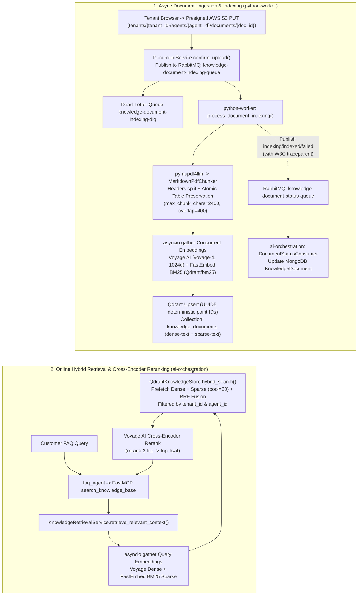
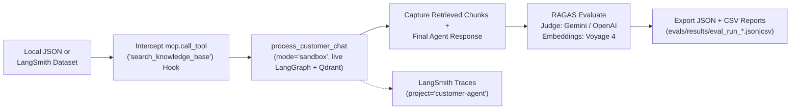

# Hybrid RAG Pipeline & Automated Evaluation

Schedulux's Retrieval-Augmented Generation (RAG) subsystem powers tenant-specific knowledge retrieval (policies, pricing sheets, PDF manuals, clinic procedures) for the customer concierge while enforcing strict multi-tenant isolation, structural table preservation, and automated quality evaluation.

**Primary Code Modules:**
- Upload URLs, tier quotas & status confirmation: `apps/AI-orchestration/src/agent_orchestrator/services/document_service.py`
- Asynchronous PDF indexing worker & Qdrant collection setup: `apps/python-worker/src/python_worker/document_indexer.py`
- Structural PDF-to-Markdown chunker: `apps/python-worker/src/python_worker/markdown_pdf_chunker.py`
- Hybrid retrieval + cross-encoder reranking: `apps/AI-orchestration/src/agent_orchestrator/services/knowledge_retrieval_service.py`
- Qdrant hybrid search & deletion store: `apps/AI-orchestration/src/agent_orchestrator/adapters/qdrant_stores.py`
- FastMCP tool bridge: `apps/AI-orchestration/src/agent_orchestrator/mcp/scheduling_mcp_server.py` (`search_knowledge_base`)
- Status synchronization consumer: `apps/AI-orchestration/src/agent_orchestrator/workers/document_status_consumer.py`
- Evaluation runner & reports: `apps/AI-orchestration/evals/evaluate_rag.py`, `evals/results/`

---

## 1. End-to-End Ingestion & Hybrid Retrieval Architecture



---

## 2. Document Ingestion Pipeline (`DocumentService` + `python-worker`)

### Presigned S3 Direct Uploads & Quota Enforcement
- `DocumentService.get_upload_url(...)` checks the tenant's Redis-cached subscription tier (`max_kb_docs`, `max_kb_doc_size_mb`) before issuing a 15-minute **AWS S3 presigned URL** scoped to `tenants/{tenant_id}/agents/{agent_id}/documents/{doc_id}_{file_name}`.
- PDFs upload directly from the browser to S3 (configured via Terraform module `infra/terraform/modules/rag_storage`), avoiding API gateway memory bloat.
- Upon upload confirmation (`confirm_upload`), a persistent job is published to `knowledge-document-indexing-queue` (backed by `knowledge-document-indexing-dlq`).

### Structural Markdown Chunking & Atomic Table Preservation (`MarkdownPdfChunker`)
1. **PDF → Markdown:** `pymupdf4llm.to_markdown(...)` extracts layout-aware Markdown rather than flat plain text.
2. **Header Segmentation:** `MarkdownHeaderTextSplitter` splits on `#`, `##`, and `###` (`strip_headers=False`) so section hierarchy stays attached to every chunk (`headers` metadata).
3. **Atomic Table Preservation:** `_split_section_preserving_tables` matches Markdown pipe tables with regex and emits each table as a **single intact chunk** tagged `is_table: True`, preventing row/column splits across pricing or schedule tables.
4. **Overflow Text Splitting:** Non-table prose exceeding `2400` chars is split via `RecursiveCharacterTextSplitter` with `400`-char overlap (`["\n\n", "\n", ". ", " ", ""]`).

### Dual Vector Indexing & Reliability (`document_indexer.py`)
- **Concurrent Dense + Sparse Generation:** `asyncio.gather` generates **Voyage AI (`voyage-4`, 1024-dim cosine)** embeddings in batches of `64` (`input_type="document"`) concurrently with local **FastEmbed (`Qdrant/bm25`)** sparse vectors.
- **Deterministic Idempotency:** Each point ID uses `uuid.uuid5(uuid.NAMESPACE_URL, f"{document_id}_{idx}")`, making re-indexing safe without duplicates.
- **Payload Indexes:** Creates `KEYWORD` indexes on `tenant_id`, `agent_id`, and `document_id` plus a lowercase `TEXT` index on `content`.
- **Transient vs. Permanent Error Classification:** `async_retry_with_backoff` retries transient S3, `429` rate limit, or Qdrant errors with exponential backoff + jitter; unrecoverable failures (corrupt/empty PDF, S3 `403`/`404`, invalid API key) raise `PermanentIndexingError` and publish `status="failed"` to `knowledge-document-status-queue` with W3C `traceparent` propagation into `DocumentStatusConsumer`.

---

## 3. Online Hybrid Search & Reranking (`KnowledgeRetrievalService`)

When `faq_agent` invokes the FastMCP tool `search_knowledge_base(tenant_id, agent_id, query)`:

1. **Parallel Query Embedding:** Computes `VoyageDenseEmbedder.embed_query` (`voyage-4`) and `BM25SparseEmbedder.embed_query` (`Qdrant/bm25`) concurrently via `asyncio.gather`.
2. **Tenant-Isolated RRF Hybrid Search (`QdrantKnowledgeStore.hybrid_search`):**
   - Applies mandatory `Filter(must=[tenant_id, agent_id])` on both prefetch branches.
   - Executes Qdrant `Prefetch` against `"dense-text"` and `"sparse-text"` (default `candidate_pool_size = 20`) and merges rankings via **Reciprocal Rank Fusion (`Fusion.RRF`)**.
3. **Voyage Cross-Encoder Reranking:**
   - If candidates exceed `RETRIEVAL_TOP_K` (`4`), sends candidate texts to `voyageai.AsyncClient.rerank(model="rerank-2-lite", top_k=4)` and attaches `relevance_score`.
   - Gracefully falls back to `candidates[:top_k]` if the reranker API encounters a transient error.

---

## 4. Automated RAG Evaluation Pipeline (`RAGAS` + `LangSmith`)

`apps/AI-orchestration/evals/evaluate_rag.py` evaluates retrieval and answer quality end-to-end against live Qdrant data and the real `customer_agent` graph with **zero changes to production code**.



### Evaluation Metrics & Command
- **Reference-free metrics:** `Faithfulness` (hallucination check against retrieved chunks) and `AnswerRelevancy`.
- **Ground-truth metrics (when `ground_truth` is provided):** `ContextPrecision` and `ContextRecall`.
- **Judge & Embeddings:** Defaults to `GEMINI_MODEL` as the RAGAS judge LLM and `Voyage 4` (`VoyageLangChainEmbeddings`) for semantic similarity scoring.

```bash
cd apps/AI-orchestration
uv run python evals/evaluate_rag.py \
  --tenant-id <TENANT_ID> \
  --agent-id <AGENT_ID> \
  --dataset evals/sample_dataset.json
```

Artifacts are written to `evals/results/eval_run_<timestamp>.json` and `.csv` (for example, `evals/results/eval_run_20261119_192344.json` recorded `faithfulness: 1.0`, `context_precision: 1.0`, `context_recall: 1.0`, and `answer_relevancy: 0.4929`).
