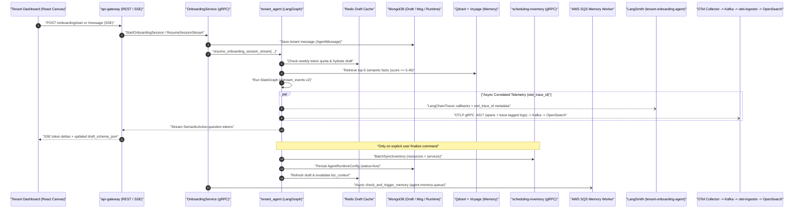
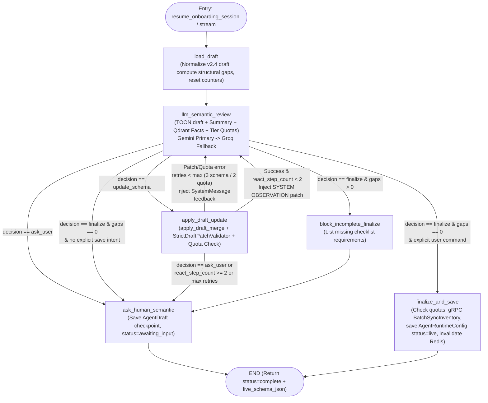

# Tenant Onboarding & Configuration Agent (`tenant_agent`)

The **Tenant Agent** is Schedulux's zero-code AI Booking Architect that turns natural-language descriptions, website crawls, and vertical templates into validated, database-backed multi-tenant scheduling configurations (`AgentRuntimeConfig`) ready for live customer traffic.

**Primary Code Modules:**
- Graph & session orchestration: `apps/AI-orchestration/src/agent_orchestrator/workflows/tenant_agent/agent.py`
- Nodes, prompt assembly & routing: `apps/AI-orchestration/src/agent_orchestrator/workflows/tenant_agent/nodes.py`
- State, checklist & structured action schema: `apps/AI-orchestration/src/agent_orchestrator/workflows/tenant_agent/state.py`
- JSON-merge & semantic ID resolution: `apps/AI-orchestration/src/agent_orchestrator/workflows/tenant_agent/tools.py`
- Gap computation, TOON formatter & deterministic greetings: `apps/AI-orchestration/src/agent_orchestrator/workflows/tenant_agent/utils.py`
- Service & memory integration: `apps/AI-orchestration/src/agent_orchestrator/services/onboarding_service.py`, `services/memory_service.py`

---

## 1. End-to-End Onboarding & Live Deployment Flow

---

## 2. LangGraph State Machine & ReAct Verification Loop

The compiled workflow (`build_tenant_onboarding_graph` in `workflows/tenant_agent/agent.py`) runs a bounded ReAct loop that validates every schema mutation against Pydantic models and subscription tier limits before showing the final confirmation to the user.

### Graph State (`GraphState`)

| Key | Purpose |
| :--- | :--- |
| `tenant_id`, `agent_id`, `tier` | Multi-tenant identity and subscription tier (`starter`, `pro`, `business`, `enterprise`) |
| `draft` | Working configuration dictionary matching the canonical v2.4 agent schema |
| `messages` | `add_messages`-annotated sequence containing rehydrated turns and ReAct `SystemMessage` observations |
| `structural_gaps` | Dynamically computed list of missing deployment prerequisites (`STRUCTURAL_REQUIREMENTS`) |
| `decision`, `pending_draft_update` | Output decision from `SemanticAction` (`update_schema`, `ask_user`, `finalize`) and partial delta |
| `react_step_count`, `patch_retries` | Loop bounds preventing infinite self-correction (`MAX_REACT_STEPS = 2`, max 3 schema retries) |
| `status`, `semantic_note` | Turn lifecycle status (`onboarding`, `awaiting_input`, `complete`) and GFM markdown reply |

---

## 3. Key Architectural Patterns

### Zero-Token Deterministic Session Initialization
- Before starting any session (`start_onboarding_session`), `TokenTrackingService.check_weekly_quota` enforces the tenant's weekly AI token allowance.
- If no prior conversation exists, `start_onboarding_session` bypasses the LLM entirely and calls `generate_deterministic_onboarding_greeting(draft, gaps)`, returning a vertical-aware welcome (`web_crawl`, `medical`, `auto`, `hospitality`, `salons`, `consulting`, or `custom`) and the first missing checklist prompt in **under 2ms with 0 tokens**.

### Token-Optimized Context & TOON Serialization
- Rather than passing raw, deeply nested JSON schemas in every prompt, `_format_draft_toon(draft)` in `utils.py` serializes `business_profile`, `operating_hours`, `resources`, `services`, `scheduling_engine`, `guardrails`, `widget_config`, and `supervisor_prompt` into a compact tabular **TOON** representation.
- `STATIC_SYSTEM_PROMPT` stays constant across turns to maximize provider prompt caching while dynamic context (`conversation_summary`, Qdrant facts, TOON draft, tier quotas, structural gaps, and ReAct observations) is appended per turn.

### Long-Term Rolling Memory & Fact Retrieval
- Unsummarized chat history is rehydrated from MongoDB `AgentMessage` (`seq > last_summarized_seq`) within `MEMORY_TRIGGER_TOKEN_THRESHOLD` (`3000` tokens).
- `node_llm_semantic_review` embeds the latest user message via Voyage (`embed_query`) and retrieves up to 5 permanent business rules/facts from Qdrant (`agent_semantic_memory`, `score_threshold=0.45`), combined with `AgentDraft.conversation_summary`.
- After each turn (`OnboardingService`), `MemoryService.check_and_trigger_memory` enqueues asynchronous consolidation jobs on AWS SQS (`agent-memory-queue`) so older turns are summarized and distilled into Qdrant facts without blocking user latency.

### Minimal-Delta JSON Merge & Semantic ID Integrity (`tools.py`)
- The LLM emits only modified fields in `SemanticAction.draft_update` (`StrictDraftPatchValidator`), never echoing unchanged arrays.
- `apply_draft_merge` uses `jsonmerge` (`arrayMergeById` keyed on `service_id`, `resource_id`, and `blackout_dates.date`):
  - **Idempotent Name/ID Matching:** Matches incoming services or resources by normalized name or existing ID to avoid duplicates, or generates deterministic-prefix semantic IDs (`srv_<slug>_<hex>`, `res_<slug>_<hex>`).
  - **Relational Remapping:** Updates `services[].resource_requirements[].eligible_resource_ids` when resource IDs are normalized.
  - **Soft-Delete Cascade:** Marking a resource `is_deleted=True` sets `dispatch_status="retired"`, `is_bookable=False`, and strips its ID from all service requirements automatically.

### Multi-Layer Guardrails & Safe Live Deployment
1. **Tier Capacity Enforcement:** Checked both in the LLM prompt (`tier_quota_block`), deterministically inside `node_apply_draft_update` (`TierQuotaExceededException`), and again before publishing in `node_finalize_and_save`.
2. **Checklist Gate (`STRUCTURAL_REQUIREMENTS`):** Blocks finalization until `business_profile.name`, `vertical`, `timezone`, `public_phone`, weekday `operating_hours`, at least one active service (with duration, buffer, price, and assigned `resource_requirements`), and at least one active resource are configured.
3. **Explicit User Confirmation Gate (`route_semantic`):** Prevents autonomous publishing even when gaps reach zero—requires explicit deployment intent (`save`, `deploy`, `publish`, `go live`, etc.) in the user's message.
4. **Atomic Inventory Sync (`finalize_and_save`):** Syncs canonical resources and services via gRPC (`sync_agent_inventory` → `BatchSyncInventory` on `scheduling-inventory`), saves `AgentRuntimeConfig` (`status="live"`), snapshots `AgentDraft`, and invalidates Redis `biz_context` and `tenant_agents` caches.

---

## 4. Real-Time Token Streaming & LLM Failover

- **Streaming Structured Output (`resume_onboarding_session_stream`):** Runs `_graph.astream_events(initial, version="v2")` and listens for `on_parser_stream` chunks on `SemanticAction.question`, streaming incremental Markdown text tokens to the frontend canvas while waiting for `on_chain_end` to emit the finalized `done` payload (`draft_schema_json` and `live_schema_json`).
- **Provider Failover:** Configured via `workflows/llm_factory.py`—invokes **Gemini** first (`GEMINI_API_KEY` / `GEMINI_MODEL`) and automatically falls back to **Groq** (`GROQ_API_KEY` / `GROQ_MODEL`) if the primary structured output call fails.
- **Observability & Billing:** Attaches OpenTelemetry trace metadata (`otel_trace_id`, `tenant_id`, `agent_id`, `tier`) to `LangChainTracer(project_name="tenant-onboarding-agent")` for **LangSmith** LLM run inspection, exports OTLP spans/logs (`:4317`) through **OTel Collector → Kafka (`otel-traces`, `otel-logs`) → `otel-ingestor` → OpenSearch** (with metrics to Grafana Cloud), and records token usage via `TokenTrackingService.record_tokens(..., source="tenant_agent")`.
